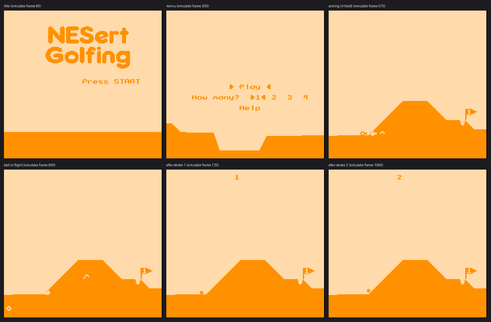

# NESert Golfing for Uzebox

A port of **NESert Golfing** by Brad Smith

https://github.com/bbbradsmith/NESertGolfing

Which was itself derived from *Desert Golfing* by Justin Smith (2014), to the Uzebox using **video mode 6** (monochrome 1bpp RAM-tile bitmap).

Note this requires a patched video mode 6 to build, see Building section below.

Uzebox port by Dan MacDonald 2026

## Controls

A SNES pad and/or a SNES mouse, in either port; the intended setup is **pad in port 1, mouse in port 2**. Both can be
used at the same time. There is **no mouse cursor** (as on the NES): moving the mouse does nothing on its own; it acts
while a button is held (aiming) and, on the menu page, a firm movement moves the selection.

| | Pad | Mouse |
|---|---|---|
| Logo page: start a 1-player game | START | left button |
| Logo page: open the menu page | A, B, SELECT or DOWN | right button |
| Swing | hold A, aim with the directions, release | hold left button, drag to aim, release |
| Fine aim | also hold B | also hold right button |
| Menu: start / open Help | START, or A/B on *Play* / *Help* | left button |
| Menu: move selection | UP, DOWN, SELECT | move the mouse up/down |
| Menu: players | LEFT/RIGHT (or A) on *How many?* | move left/right on that row, or right button anywhere |
| Soft reset | A+B+SELECT+START | — |

While a mouse is plugged in and answering, the logo page says *Press START or click* instead of *Press START*: a quick
check on hardware that the mouse is recognised. The one-press start from the logo page is a port addition (the NES title
shows the menu with *Play* preselected, where START also starts at once).

The swing pulls the ball back, as on the NES: pull (or drag) left/down to shoot right/up. Mouse steps match the NES
(8 swing units per mouse count, 1 with the right button; a pad direction is 32 per frame, 1 with B). In the menus a mouse
movement counts only if it is at least 12 counts in one frame, and the next one is ignored for 24 frames.

## Building

Host tests (gcc + Python/Pillow): `./run_tests.sh` — plays 120 holes (and the forced ocean hole) with a bot that
`fork()`s the game, tries swings headless, and plays the best. Screenshots land in `test_out/` as PPM.

Uzebox: copy this folder to `uzebox/demos/NESert/` (so `../../../kernel` resolves), apply `kernel_patch/` to the kernel once
(see `kernel_patch/README`; restore the original `videoMode6` files first if you applied an earlier version), then `cd default && make`.
The Makefile passes `-DCONTROLLERS_VSYNC_READ=0 -DSNES_MOUSE=0` (the port reads the controllers itself); `plat_uzebox.c` stops
with an `#error` otherwise. All objects depend on the Makefile, so changing `KERNEL_OPTIONS` rebuilds the kernel objects too
(make does not track flags; a stale kernel object from an older build would silently keep the old options). `tools/typecheck_kernel.sh <kernel dir>` re-checks `plat_uzebox.c`
against your kernel headers without a toolchain.

`gameinfo.properties`: the `.uze` header's author field holds 32 characters, so `packrom` cuts the current author line after
`Brad Smith (original NES game); ` (the ROM itself is unaffected). `packrom` also warns `Unknown Option [genre=0]`.

**How the port reads the controllers** (`plat_uzebox.c`). The first hardware test, with a Hyperkin "Hyper Click" mouse,
failed: the mouse was not recognised in either port. The kernel's reader clocks the first 16 bits about 1 µs apart, and
the Hyperkin is documented to return corrupted reports when read faster than about 7.9 µs per bit, with at least 15.6 µs
before bit 17 (SNESdev wiki, *Mouse*). (Catacombs of the Damned uses the same kernel reader and is reported to work with
the Hyperkin in port 1, so this is the most likely cause, not a proven one.) So the kernel's reading is switched off
(`-DCONTROLLERS_VSYNC_READ=0 -DSNES_MOUSE=0`) and a pre-VSYNC callback reads both ports itself: bits at least 9 µs apart
(10.6 µs measured in cuzebox-ex), 20 µs or more before bit 17 (40.8 µs measured), the second 16 bits only when a port
reports a mouse. That takes 0.46 ms per frame with a mouse (measured; roughly half with pads only, not measured), inside the VSYNC interrupt, so
it costs some of mode 6's little free time (the hole scroll gets a little slower).

Each port's report is then classified: bit 15 clear = pad; first byte zero and signature `0001` = mouse; anything else is
a corrupted read and is ignored. A port that reported a mouse in the last second is never read as a pad, so a bad read
cannot turn into pad presses (a mouse's buttons are bits 8/9, the same bits as a pad's A/X). Mouse motion is summed every
VSYNC, so frames that span several VSYNCs lose none; `plat_mouse()` hands it out with interrupts off for a few dozen cycles.

Not used, on purpose: `EnableSnesMouse()` (needs sprites, which mode 6 doesn't have) and `SetMouseSensitivity()`, whose
retry loop counts up (`retries++`) and so never ends with a mouse that ignores sensitivity changes, such as the Hyperkin.
The mouse stays at its own sensitivity (the Hyperkin has a button underneath for it); the NES game switches a Nintendo
mouse to medium, so with a Nintendo mouse at low sensitivity a swing takes more hand movement than on the NES.
`MSWING_COARSE`/`MSWING_FINE` in `game.c` are the knobs.

## How it works

The NES draws a scrolling heightmap by streaming tiles into CHR-RAM. Mode 6 has no scrolling and no
sprites, so the port is a small software renderer over mode 6's tile map:

* **Terrain**: the 256-entry ring buffer `floor_y[]` (+ `floor_a[]`, the slope index used by physics) is rasterised
  straight into ramtiles. Per 8px column only the tile rows the surface passes through get a unique
  ramtile (bit-sliced build, ~16 ops per tile); rows above are blank (index 0), rows below share one
  solid tile; flat runs reuse the left neighbour's tile. Rebuilt only when something static changes.
  A full rebuild takes **about 5 frames** in mode 6 (measured in Uzem), so the screen shows it half-done. It is therefore
  written to stay correct while visible: VRAM is **not cleared first** (every cell is written once with its final value,
  terrain first, then text into the cells the terrain left blank), and in the game scene the base ramtiles are allocated
  as a **ring** in `[RT_FIRST, RAMTILES-DYN_MAX)`: a rebuild first uses the tiles the previous one left free and only then
  reuses the previous build's tiles, leftmost columns (already redrawn) first. Overlay tiles are the fixed block
  `[RAMTILES-DYN_MAX, RAMTILES)` in the game scene. Title/menu/help pages allocate from `RT_FIRST` as before.
  (The earlier version cleared VRAM and restarted at `RT_FIRST`, which showed as the terrain blanking and wiping in from the
  left every ~5 frames during the hole scroll, plus stray tile fragments: `docs/uzem_scroll_before_after.png`.)
* **Sprites / weather**: drawn copy-on-write into extra ramtiles on top of the base layer and undone next frame from a
  small undo log. XOR for balls/rings (visible on both sky and ground), OR for the rest.
* **Vector shapes**: the flagpole, pennant tip and top edge, the swing rings (full ring and rotating half-arc), the
  highlighted ball (filled disc) and the glow markers are drawn as horizontal/vertical **line runs**
  (`vector_draw()` in `render.c`, shape codes `T_V*` in `nesert.h`), not from bitmaps. These use this port's own line
  primitives rather than the kernel's mode 6 `SetPixel`/line routines, because the kernel keeps its own ramtile
  bookkeeping that would conflict with the base/overlay layering. The balls (rolling highlight) and flag numerals
  remain 1bpp bitmaps.
* **Colour**: a mono mode, so sky = background, ground = foreground, and a per-scanline foreground
  override for the band holding the status/menu text. Day/night, fades and weather palettes are all
  preserved as colour changes. Player identity is by ball *shape* (disc / ring / ring+dot / ring+cross).
* **Game code** mirrors the NES source function by function (same names, same fixed-point maths,
  same PRNG), so the two can be read side by side. `fmult` is `(a*b)>>8`, identical to the asm.

`tools/gen_data.py` regenerates all tables/graphics from the NES sources (slopes use the original algorithm;
font/logo/sprites come from the original PNGs).

## Deliberate deviations from the NES game

* **Playfield 240×224** instead of 256×240: columns 30–31 and the top/bottom 8 lines are cropped (the NTSC overscan).
  Hole placement uses 32 columns as the "2 tiles off-screen" minimum instead of 34.
* **Two-page title**: logo page, then menu page, because logo + menu + terrain needs ~160 ramtiles.
  Builds with `RAMTILES >= 168` get the original single page (`TITLE_SPLIT`).
* **Help page** is text over a flat strip (no scroll-in animation, no second terrain).
* **Not ported**: Tournament Edition. (The SNES mouse *is* supported; differences: sensitivity is not set, see *Controls*.)
* **Ocean** is a dithered water strip (mono can't colour it blue). Splash/ball shading is simplified to 1bpp.
* The 512-pixel terrain ring is stored as 256 pixels (coordinates stay mod 512). The hole "lip" is only
  applied when the hole is on screen (off-screen terrain isn't stored).

## Upstream quirk, preserved

`hole_next()` in the NES source sets **both** `fg_hold_mask` and `fg_angle_mask` from `course_hm[]`;
`course_am[]` is never used. That is how the shipped ROM generates terrain, so it is reproduced.
Define `USE_COURSE_AM` to use the table that looks like it was intended (host tests pass either way).

## Testing in cuzebox-ex (headless)

Emulator tests use **cuzebox-ex** (<https://github.com/weber21w/cuzebox-ex>), which emulates a SNES mouse in either port and has
a localhost command API (load a ROM, set each port's 32-bit report per frame, run N frames, read memory and symbols,
screenshots, a cycle-stamped logic trace of the controller lines). Build it with `make -B TSYS=linux` (needs `libsdl2-dev`,
`libasound2-dev`). Then, in `tools/cuzebox_headless/` (with `CUZEBOX_EX_DIR` pointing at the checkout; needs Xvfb, xdotool,
Python with Pillow):

* `start.sh` starts cuzebox-ex on its own Xvfb display with the API enabled, game-picture-only display and no frame limiter.
* `czrun.py` is a small driver: `pad(...)` and `mouse(dx, dy, L, R)` build port reports, `Run.play(port1, port2, shots, ...)`
  plays them frame by frame and saves screenshots.
* `test_input.py ../../default/NESert.hex ../../default/NESert.elf <dir>` runs the input tests (11, all passing): the mouse
  prompt appears with a mouse in port 2; START (pad) or a left click starts a 1-player game from the logo page; A or a right
  click opens the menu; a mouse in port 1 works too; a corrupted mouse report, and a single pad-like read from a mouse port,
  do not press anything; and a swing dragged with the mouse gives the same 44 screenshots and ball position as the same swing
  on the pad.

Read timing was measured with the API's `LOGIC_TRACE` (clock/latch edges with cycle stamps): see *Controls*.
Limits: cuzebox-ex does not model the Hyperkin's speed limit (its mouse answers at any speed), so it can show that the timing
now meets the documented limit but not that a Hyperkin then works; only hardware can. Screenshots include cuzebox-ex's message
overlay at the bottom of the picture. The emulator's frame count also includes boot frames, so test frame numbers are counted
from `LOAD_ROM`.

The course seed takes the video timer (cycle-exact) when the game starts, so any difference in code path before that (another
button, another device plugged in, another build) gives another course; compared runs must start the same way.

## Licence

NESert Golfing (game logic, graphics, sound scripts): **CC BY 4.0**, © Brad Smith. This port is a derivative
work and keeps that attribution. The Uzebox kernel is GPLv3; a built ROM links it, so distributing a ROM
carries the GPLv3 obligations for the combined work.
