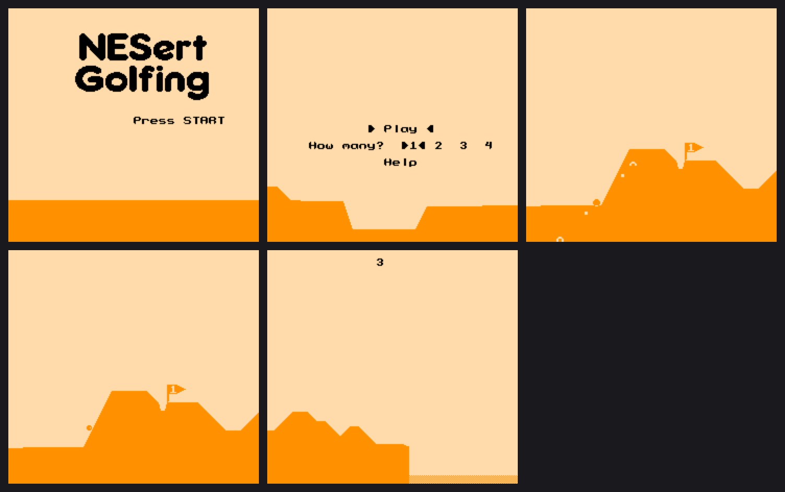

# NESert Golfing for Uzebox

This is port of **NESert Golfing** by Brad Smith (2019–2022), itself derived from *Desert Golfing* by
Justin Smith (2014), to the Uzebox using a modified **video mode 6** (monochrome 1bpp RAM-tile bitmap).

This port was magicked here under the supervision of Dan MacDonald, Based on the source code downloaded from: <https://github.com/bbbradsmith/NESertGolfing> (CC BY 4.0).

Building this game requires patching video mode 6's kernel source as described in the **Building** section below.

## Building

Host tests (gcc + Python/Pillow): `./run_tests.sh` — plays 120 holes (and the forced ocean hole) with a bot that
`fork()`s the game, tries swings headless, and plays the best. Screenshots land in `test_out/` as PPM.

Uzebox: copy this folder to `uzebox/demos/NESert/` (so `../../../kernel` resolves), apply `kernel_patch/` to the kernel once
(see `kernel_patch/README`; restore the original `videoMode6` files first if you applied an earlier version), then `cd default && make`. `tools/typecheck_kernel.sh <kernel dir>` re-checks `plat_uzebox.c`
against your kernel headers without a toolchain.
`tools/typecheck_kernel.sh <kernel dir>` to re-check `plat_uzebox.c` against your kernel checkout.

## How it works

The NES draws a scrolling heightmap by streaming tiles into CHR-RAM. Mode 6 has no scrolling and no
sprites, so the port is a small software renderer over mode 6's tile map:

* **Terrain**: the 256-entry ring buffer `floor_y[]` (+ `floor_a[]`, the slope index used by physics) is rasterised
  straight into ramtiles. Per 8px column only the tile rows the surface passes through get a unique
  ramtile (bit-sliced build, ~16 ops per tile); rows above are blank (index 0), rows below share one
  solid tile; flat runs reuse the left neighbour's tile. Rebuilt only when something static changes.
* **Sprites / weather**: drawn copy-on-write into extra ramtiles on top of the base layer and undone next frame from a
  small undo log. XOR for balls/rings (visible on both sky and ground), OR for the rest.
* **Vector shapes**: the flagpole, pennant tip and top edge, the swing rings (full ring and rotating half-arc), the
  highlighted ball (filled disc) and the glow markers are drawn as horizontal/vertical **line runs**
  (`vector_draw()` in `render.c`, shape codes `T_V*` in `nesert.h`), not from bitmaps. These use this port's own line
  primitives rather than the kernel's mode 6 `SetPixel`/line routines, because the kernel keeps its own ramtile
  bookkeeping that would conflict with the base/overlay layering. The balls (rolling highlight) and flag numerals
  remain 1bpp bitmaps.
* **Colour**: a mono mode, so sky = background, ground = foreground, and a per-scanline foreground
  override for the band holding the status/menu text. Day/night, fades and weather palettes are all
  preserved as colour changes. Player identity is by ball *shape* (disc / ring / ring+dot / ring+cross).
* **Game code** mirrors the NES source function by function (same names, same fixed-point maths,
  same PRNG), so the two can be read side by side. `fmult` is `(a*b)>>8`, identical to the asm.

`tools/gen_data.py` regenerates all tables/graphics from the NES sources (slopes use the original algorithm;
font/logo/sprites come from the original PNGs).

## Deliberate deviations from the NES game

* **Playfield 240×224** instead of 256×240: columns 30–31 and the top/bottom 8 lines are cropped (the NTSC overscan).
  Hole placement uses 32 columns as the "2 tiles off-screen" minimum instead of 34.
* **Two-page title**: logo page, then menu page, because logo + menu + terrain needs ~160 ramtiles.
  Builds with `RAMTILES >= 168` get the original single page (`TITLE_SPLIT`).
* **Help page** is text over a flat strip (no scroll-in animation, no second terrain).
* **Not ported**: Tournament Edition, NES mouse support (so the mouse text was removed from help).
* **Ocean** is a dithered water strip (mono can't colour it blue). Splash/ball shading is simplified to 1bpp.
* The 512-pixel terrain ring is stored as 256 pixels (coordinates stay mod 512). The hole "lip" is only
  applied when the hole is on screen (off-screen terrain isn't stored).

## Upstream quirk, preserved

`hole_next()` in the NES source sets **both** `fg_hold_mask` and `fg_angle_mask` from `course_hm[]`;
`course_am[]` is never used. That is how the shipped ROM generates terrain, so it is reproduced.
Define `USE_COURSE_AM` to use the table that looks like it was intended (host tests pass either way).

## Licence

NESert Golfing (game logic, graphics, sound scripts): **CC BY 4.0**, © Brad Smith. This port is a derivative
work and keeps that attribution. The Uzebox kernel is GPLv3; a built ROM links it, so distributing a ROM
carries the GPLv3 obligations for the combined work.
